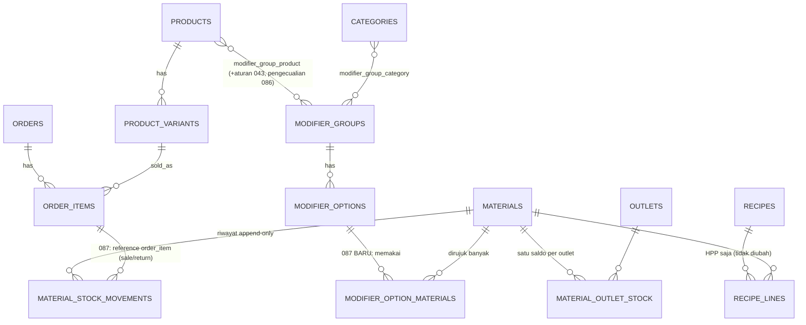

# Penilaian Arsitektur: Pilihan Modifier Memakai Bahan Baku

**Klasifikasi**: CONFIDENTIAL (memuat struktur data dan kontrol internal)

**Feature**: [spec.md](./spec.md) · **Tanggal**: 2026-10-31 · **Status**: masukan pra-plan; akan dipindah ke `research.md` saat `/speckit-plan`.

Fakta di bawah diambil dari kode di branch `develop-warkop-wjm` (61ef05b5). Yang bukan fakta diberi label **ASUMSI** atau **REKOMENDASI**.

---

## 1. Kondisi sistem hari ini (fakta)

| Area | Yang ada | Sumber |
|---|---|---|
| Grup & pilihan modifier | `modifier_groups` (single/multiple, min/max, required), `modifier_options` (`price_delta`), ditautkan ke produk (`modifier_group_product`, dengan aturan penimpaan 043) dan kategori (`modifier_group_category`), pengecualian per item (086). Satu menu sudah bisa punya banyak grup. | `2026_10_31_000004`, `2026_11_05_000007`, `2026_12_29_000001` |
| Pembaca/validator modifier | `ModifierResolver::resolve()` memvalidasi pilihan dan menghasilkan snapshot `{group_id, group, option_id, option, price_delta}` | `app/Services/ModifierResolver.php:100-150` |
| Snapshot di pesanan | `order_items.modifiers` (JSON) | `2026_10_31_000006` |
| Bahan baku | `materials` (`unit` string, `kind` ingredient/semi_finished/packaging, `standard_cost`, `HasDataMode`) | `2026_10_08_000001`, `2026_11_05_000002` |
| Saldo bahan | `material_outlet_stock` (decimal 14,3, CHECK ≥ 0) + `materials.current_stock` sebagai total | `2026_12_04_000001` |
| Riwayat bahan | `material_stock_movements`, append-only, `type` ENUM `purchase, adjustment, transfer_out, transfer_in, transfer_cancel`. **Tidak ada jenis penjualan.** | `2026_12_04_000001` |
| Penulis stok bahan | `MaterialStockService::applyMovement()`: kunci baris bahan + saldo outlet, tolak bila minus | `app/Services/MaterialStockService.php` |
| BOM & resep | `product_variant_bom_lines`, `recipes/recipe_variants/recipe_lines` (versi, yield, shrinkage). **Hanya untuk HPP** (`RecipeService::applyDueCached()` memperbarui `cost_price`); tidak memotong stok. | `OrderService.php:36`, `TabService.php:150` |
| Stok produk saat jual | `StockService::applyMovementIfTracked()`: ritel saat checkout, tab saat baris ditambah, dikembalikan saat kurangi/hapus/void/refund; batal baris yang sudah dimasak memakai `stock_decision` | `OrderService.php:228,272`, `TabService.php:204,249,325,451`, `RefundService.php:96` |
| Idempotensi | `orders.local_ref` (ritel), `local_ref` tab, `payments.submission_ref` | `OrderService`, `TabService::open` |

**Temuan sampingan (fakta)**: checkout ritel mencatat movement `sale` dengan `reference_id = order.id` (`OrderService.php:234`), sedangkan `return` memakai `order_item.id` (`OrderService.php:278`) dan tab memakai `order_item.id`. Rujukan ini tidak konsisten. Fitur ini harus memakai `order_item.id` di semua tempat; memperbaiki movement produk lama adalah keputusan terpisah.

### Jawaban Q1: bisa tanpa perubahan arsitektur besar?

**Ya.** Semua bagian berat sudah ada: grup/pilihan, satu saldo bahan per outlet, penulis stok bahan dengan row-lock, riwayat append-only, snapshot modifier di baris pesanan, dan titik-titik jual/kembali yang sudah terpusat di tiga service. Yang kurang hanya:

1. satu tabel pemetaan (pilihan → bahan, jumlah);
2. dua jenis movement baru untuk bahan;
3. satu service kecil yang mengubah "pesanan + snapshot modifier" menjadi daftar potongan bahan, dipanggil di **tiga titik tempat pesanan menjadi `completed`** (fakta): `OrderService.php:206` (checkout ritel), `TabSettlementService.php:122` (`settle` lunas), `TabSettlementService.php:199` (`split` membuat pesanan baru yang langsung selesai);
4. saldo bahan boleh minus (keputusan FR-014 = B): CHECK ≥ 0 di `material_outlet_stock` dilepas, dan itulah satu-satunya perubahan skema yang berisiko.

**Keputusan pemilik 2026-10-31**: Q1 = B (izinkan minus + peringatan), Q2 = B (potong saat pesanan selesai).

---

## 2. Model domain (REKOMENDASI)

```
Varian        = APA yang dijual, satu dipilih, punya harga/SKU/stok sendiri  (Kopi Susu Hot / Iced)
Modifier      = BAGAIMANA disajikan, 0..n dipilih per grup, harga ± delta     (Rasa Kuah, Topping)
Bahan baku    = barang inventori, satu satuan, saldo per outlet               (Telur, butir)
Pemakaian     = "jika X dipesan sekali, pakai q satuan bahan B"
  ├─ milik pilihan modifier  → fitur 087 (memotong stok)
  └─ milik resep/varian      → sudah ada, hanya HPP (kelak bisa memotong lewat jalur yang sama)
```

Aturan inti:

- Pemakaian adalah **baris komponen** milik pemiliknya (pilihan modifier), bukan kolom di pilihan. Bentuknya sama dengan `recipe_lines` (bahan + jumlah), sehingga kelak resep menu bisa memakai mesin potong yang sama.
- Bahan tidak pernah tahu siapa pemakainya; saldo tetap satu per (bahan, outlet, mode). Itulah jawaban **Q4**: berbagi bahan terjadi otomatis karena banyak baris komponen menunjuk ke satu `material_id`.
- Yang dipotong ditentukan dari **snapshot** pesanan (option_id yang benar-benar dipilih) + pemetaan saat dibukukan; hasil potongan disimpan sebagai movement, dan movement itulah sumber kebenaran untuk pengembalian.

---

## 3. Skema (REKOMENDASI, sketsa; nama final diputuskan di plan)

```sql
-- Baru
CREATE TABLE modifier_option_materials (
  id                 BIGINT UNSIGNED PK,
  modifier_option_id BIGINT UNSIGNED NOT NULL  -- FK modifier_options, CASCADE (pemetaan ikut pilihan)
  material_id        BIGINT UNSIGNED NOT NULL  -- FK materials, RESTRICT (bahan terpakai tak bisa dihapus keras)
  quantity           DECIMAL(12,4)   NOT NULL  -- > 0, satuan = materials.unit
  data_mode          ENUM('demo','live')       -- HasDataMode, wajib (aturan 003)
  created_at, updated_at,
  UNIQUE (modifier_option_id, material_id),
  INDEX (material_id),                         -- "siapa memakai bahan ini" (FR-005)
  CHECK (quantity > 0)
);

-- Diperluas
ALTER TABLE material_stock_movements MODIFY type ENUM(
  'purchase','adjustment','transfer_out','transfer_in','transfer_cancel',
  'sale','return','waste'                      -- 087: pemakaian, pengembalian, terbuang
);
-- reference_type = 'order_item', reference_id = order_items.id (selalu baris, bukan order)
-- Indeks (reference_type, reference_id) SUDAH ada → pengembalian membaca potongan bersih per baris.

-- FR-014 = B (izinkan minus):
ALTER TABLE material_outlet_stock DROP CHECK chk_material_outlet_stock_nonneg;
-- Penjaga pindah ke service: MaterialStockService menolak minus KECUALI type IN ('sale','waste').
-- materials.current_stock (total) ikut boleh minus. Kolom stock_before/stock_after sudah bertanda.
```

**Penjaga idempotensi penyelesaian** (FR-017): ketiga titik selesai sudah berjalan di bawah `lockForUpdate` pesanan dan hanya bertransisi dari `open` (settle) atau membuat pesanan baru (checkout, split). Sebagai sabuk pengaman: sebelum memotong, periksa apakah sudah ada movement `sale` untuk baris-baris pesanan itu; bila ada, lewati. ASUMSI: plan memutuskan apakah penjaga ini cukup sebagai query atau perlu kolom penanda `orders.materials_consumed_at`.

Tidak perlu kolom baru di `order_items`: potongan bersih per baris = Σ `qty_change` movement bahan dengan `reference_type='order_item' AND reference_id = id`. Ini juga menjawab "pemetaan berubah setelah jual" tanpa menyalin pemetaan ke JSON baris.

**ASUMSI**: `quantity` 4 desimal mengikuti `recipe_lines` dan `product_variant_bom_lines`; saldo bahan 3 desimal. Hasil kali dibulatkan ke 3 desimal sekali per baris per bahan.

### ERD



---

## 4. Alur potong (REKOMENDASI)

Satu service baru, misalnya `ModifierMaterialConsumption` (nama final di plan), satu-satunya yang menerjemahkan baris → potongan bahan, dan semua tulis tetap lewat `MaterialStockService::applyMovement()`.

```
Titik selesai (DB::transaction + lock pesanan yang SUDAH ada):
  OrderService::checkout     → order dibuat 'completed'           (ritel; local_ref = idempotensi)   ← Q8 retry
  TabSettlementService::settle → open → completed saat lunas
  TabSettlementService::split  → pesanan baru 'completed' berisi baris yang dipilih
        │
        ▼  NEW ModifierMaterialConsumption::consumeFor(order, user)   (satu-satunya penerjemah)
 1. penjaga: sudah ada movement 'sale' untuk baris pesanan ini? → lewati                 ← FR-017
 2. muat pemetaan untuk SEMUA option_id dari order_items.modifiers dalam satu query
 3. per baris: need[material] = Σ_option (quantity × line.qty)                          ← Q5
 4. lewati bahan nonaktif/terhapus; urutkan (line_id, material_id) ASC → urutan kunci tetap
 5. MaterialStockService::applyMovement(material, order.outlet_id, 'sale', -need,
                                        'order_item', line.id, user)
       └─ lockForUpdate materials + material_outlet_stock                               ← Q8 konkurensi
       └─ saldo jadi minus → diizinkan (FR-014=B), kumpulkan peringatan
 6. tambahkan biaya bahan ke order_items.cost_price / orders.total_cost (FR-023)
 7. commit bersama status 'completed' dan pembayaran; respons membawa "warnings"
```

**Selama tab terbuka** (FR-016): tambah/kurangi/ganti pilihan/hapus/pindah/gabung tidak menyentuh bahan. Stok PRODUK tetap seperti hari ini (dipotong saat item masuk tab).
**Batal baris "buang" di tab terbuka** (FR-018): `TabService::removeLine` dengan `stock_decision=waste` (nilai sah: `return`, `waste`; `CancelTabLineRequest.php:26`) → `consumeLine(line, 'waste')` sebelum baris dihapus. `return` → tidak ada pergerakan bahan. `voidTab` berlaku sama per baris.
**Pengembalian (Q6)**: void pesanan selesai (`OrderService::void`) dan refund (`RefundService::refund`) → baca potongan bersih `sale` − `return` per (baris, bahan) dari movement, tulis `return` sebesar itu. `waste` tidak pernah dikembalikan. Refund/void dijaga oleh status pesanan yang dikunci (`refunded_at`, `status`), jadi tidak bisa terjadi dua kali.

**Split**: tidak perlu penanganan khusus lagi. `split` menyalin `modifiers` ke baris baru di pesanan `completed` (`TabSettlementService.php:208-221`), jadi pesanan itu memotong bahannya sendiri di titik selesai; sisa tab memotong saat ia lunas.

**Catatan rujukan baris yang dihapus**: movement `waste` merujuk `order_item.id` yang lalu dihapus (`$line->delete()` di `TabService`). Riwayat tetap bisa dibaca lewat `reference_id`, tetapi tautan ke baris hilang; plan perlu memutuskan apakah movement menyimpan juga `order_id` atau label baris (pola `StockMovementReferences`).

---

## 5. Stok tidak cukup (Q7)

| Opsi | Untuk | Melawan |
|---|---|---|
| **A. Tolak (409)** | Konsisten dengan penulis bahan hari ini (CHECK ≥ 0); stok selalu jujur | Restoran sering salah hitung bahan; kasir terhenti padahal telur ada di dapur → kasir mencari jalan pintas (pilih "tanpa topping" lalu catat manual) |
| **B. Izinkan minus + peringatan** | Penjualan tak pernah terhenti; minus menjadi sinyal untuk stok opname | Perlu lepas CHECK; saldo minus harus ditampilkan jelas di laporan stok rendah |
| **C. Per bahan** | Fleksibel (telur = tolak, garam = izinkan) | Satu pengaturan lagi per bahan; lebih banyak kasus uji |

**DIPUTUSKAN 2026-10-31: B.** Saldo boleh minus hanya untuk `sale`/`waste`; bahan minus ditandai di daftar bahan dan laporan stok rendah (`LowStockHistory`); koreksi manual dan transfer keluar tetap ditolak bila hasilnya minus.

---

## 6. Pecahan & satuan (Q9)

- **Pecahan: ya.** Saldo bahan sudah decimal(14,3) dan resep 4 desimal; "2 gram cabai" dan "0,5 sdt garam" butuh ini.
- **Satuan berbeda: belum.** `materials.unit` adalah string tunggal tanpa konversi. Pemakaian dinyatakan dalam satuan bahan. Konversi (beli per kg, pakai per gram) adalah fitur sendiri: tabel `material_unit_conversions` (unit, faktor ke satuan dasar) yang dipakai bersama PO, resep, dan modifier. Menunda konversi tidak mengunci desain karena `quantity` selalu dalam satuan dasar.

---

## 7. Perbandingan pendekatan (Q2, Q3)

| | **A. Kolom di pilihan** (`modifier_options.material_id`, `consumption_qty`) | **B. Baris komponen per pilihan** (`modifier_option_materials`) | **C. Komponen generik polimorfik** (`consumption_components(owner_type, owner_id, material_id, qty)` untuk pilihan + varian + resep) | **D. Modifier sebagai produk tambahan** (pilihan = varian tersembunyi dengan BOM) |
|---|---|---|---|---|
| Satu pilihan, banyak bahan (Extra Pedas) | ✗ | ✓ | ✓ | ✓ |
| Kerumitan skema | sangat rendah | rendah (1 tabel) | sedang; FK polimorfik tanpa integritas referensial MySQL | tinggi |
| Integritas FK | ✓ | ✓ | ✗ (owner_type string) | ✓ |
| Cocok dengan resep yang sudah ada | ✗ | ✓ bentuk sama dengan `recipe_lines` | perlu migrasi `recipe_lines` (yang berversi) ke tabel generik | ✗ |
| Dampak ke katalog/laporan | nol | nol | nol | besar: varian palsu muncul di Produk, stok, ekspor, laporan |
| Jalan ke resep penuh | buntu | mesin potong dipakai ulang; resep kelak memanggil service yang sama | langsung | — |

**Q3**: pemetaan di tingkat pilihan modifier, tetapi lewat entitas komponen kecil (B), bukan kolom tunggal (A). Entitas "recipe component" generik (C) adalah abstraksi prematur: resep di sistem ini sudah punya versi, yield, dan shrinkage, sedangkan pemakaian pilihan tidak. Menyatukannya sekarang memaksa satu model melayani dua kebutuhan yang berbeda.

---

## 8. Sketsa API (REKOMENDASI)

Pilihan sudah disimpan bersama grupnya lewat `apiResource('modifier-groups')` (`routes/api.php:357`), jadi pemetaan ikut payload yang sama, tanpa endpoint baru untuk menulis:

```http
PUT /api/v1/modifier-groups/{id}
{
  "name": "Topping", "selection_type": "multiple", ...,
  "options": [
    { "id": 31, "name": "Telur", "price_delta": "3000.00",
      "materials": [ { "material_id": 7, "quantity": "1" } ] },        // ada kunci = ganti penuh
    { "id": 32, "name": "Sosis", "price_delta": "4000.00" }             // tanpa kunci = tidak berubah (pola 086)
  ]
}
→ 200 options[].materials[]: { material_id, code, name, unit, quantity: "1.0000", is_active }
→ 422 materials.0.quantity (≤ 0), materials.1.material_id (duplikat / nonaktif / beda mode)
```

```http
GET /api/v1/materials/{id}            → + "used_by_modifier_options": [{ option_id, option, group_id, group }]
GET /api/v1/materials/{id}/movements?type=sale,return   → baris dengan reference { order_number, order_item_id }
POST /api/v1/orders, POST /api/v1/tabs/{id}/settle, POST /api/v1/tabs/{id}/split
     → kontrak permintaan TIDAK berubah; respons 200/201 + bidang opsional
       "warnings": [{ code: "material_negative", material_id, material, unit, stock_before, required, stock_after }]
POST /api/v1/tabs/{id}/items      → tidak berubah (tidak menyentuh bahan lagi)
```

`warnings` bersifat aditif: APK lama mengabaikannya dan transaksi tetap berhasil. ASUMSI: nama rute settle/split diverifikasi di plan.

`docs/openapi-pos-mvp.yaml` harus berubah di commit yang sama (PRD §9.5). Android tidak menghitung apa pun; ia hanya perlu menampilkan 409/peringatan dengan baik.

---

## 9. Kasus tepi & tantangan

1. **Urutan kunci**: pesanan multibaris yang menyentuh bahan sama di dua transaksi bersamaan → kunci bahan dalam urutan `material_id` naik, dan agregasikan per pesanan sebelum menulis untuk mengurangi jumlah kunci.
2. **Kinerja**: N baris × M pilihan × K bahan. Muat semua pemetaan untuk option_id di pesanan dalam satu query; satu movement per (baris, bahan).
3. **`track_stock` mati pada varian** tidak boleh mematikan potong bahan (keduanya terpisah).
4. **Bahan nonaktif/terhapus** setelah dipetakan: lewati saat jual (dan beri peringatan di layar pemetaan); pengembalian tetap memakai `withTrashed()`.
5. **Mode DEMO/LIVE**: query mentah wajib menyaring `data_mode`; `modifier_option_materials` memakai `HasDataMode`.
6. **`OutletScopeRegistry`**: setiap query mentah baru atas tabel berskop outlet wajib didaftarkan, atau `OutletScopeRegistryTest` gagal.
7. **HPP (FR-023)**: biaya bahan pilihan ditambahkan ke `order_items.cost_price` saat dibukukan, memakai sumber harga `BomCostCalculator` (vendor preferred, lalu termurah). Laporan margin lama tidak dihitung ulang.
8. **Rilis menu (086)**: bila perubahan grup modifier melewati alur `menu_change`, pemetaan bahan harus ikut payload itu.
9. **Tab lama terbuka**: bahan belum terpotong sampai lunas, jadi stok bahan hari itu tampak lebih tinggi dari fisik. Laporan stok bisa menampilkan "dipesan, belum selesai" sebagai info tambahan (di luar cakupan 087).10. **Rujukan ritel `order.id` vs `order_item.id`** (temuan §1): jangan ditiru.
11. **Ketidakselarasan waktu produk vs bahan**: stok produk dipotong saat masuk tab, bahan saat selesai. Uji paritas harus membandingkan keduanya pada titik yang benar.

---

## 10. Masa depan (Q10)

- **Resep menu memotong stok**: panggil service potong yang sama dengan sumber kedua (resep varian yang berlaku pada tanggal bisnis). Movement tetap `sale`/`return` per (baris, bahan), jadi laporan pemakaian tidak berubah bentuk.
- **Penimpaan per menu** (Telur di Nasi Goreng = 2): tabel opsional `(modifier_option_id, product_id, material_id, quantity)` yang dibaca lebih dulu; tidak mengubah tabel 087.
- **Konversi satuan, yield/shrinkage untuk pilihan, bahan setengah jadi** (`kind = semi_finished`, produksi batch), **ketersediaan otomatis** (sembunyikan pilihan bila bahan habis, lewat `MenuAvailability`), **stok opname & varians** (teoretis vs aktual dari movement `sale`).

---

## 11. Rekomendasi akhir

**Pendekatan B**: satu tabel `modifier_option_materials` + jenis movement `sale`/`return` pada `material_stock_movements` + satu service potong yang dipanggil di titik jual/kembali yang sudah ada, semua tulis lewat `MaterialStockService`.

Alasannya:

- **Perubahan kecil**: satu tabel, satu perluasan enum, satu service. Tidak ada perubahan kontrak klien bila FR-014 = tolak.
- **Integritas**: FK nyata, unik per (pilihan, bahan), satu saldo per bahan per outlet.
- **Aman transaksi**: berjalan di transaksi dan kunci yang sudah ada, dengan idempotensi `local_ref` yang sudah ada. Pengembalian membaca movement, bukan pemetaan.
- **Siap dikembangkan**: bentuk baris sama dengan resep, jadi resep penuh, penimpaan per menu, dan konversi satuan bisa ditambahkan tanpa membongkar 087.

Kedua keputusan pemilik sudah diambil (2026-10-31): FR-014 = izinkan minus, FR-015 = potong saat selesai. Q2 = B juga menyederhanakan rancangan: tidak ada potong/kembali selama tab terbuka, dan split tidak butuh penanganan khusus.
